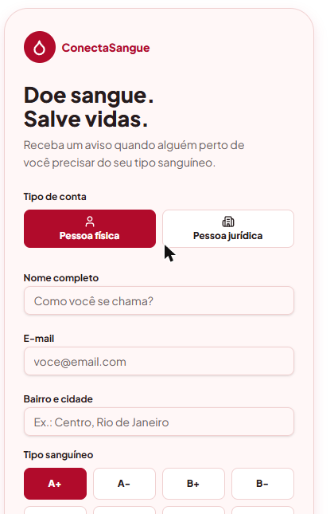
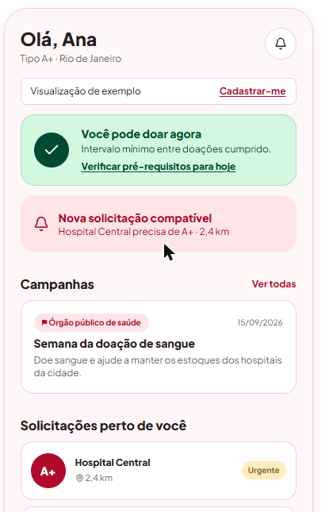
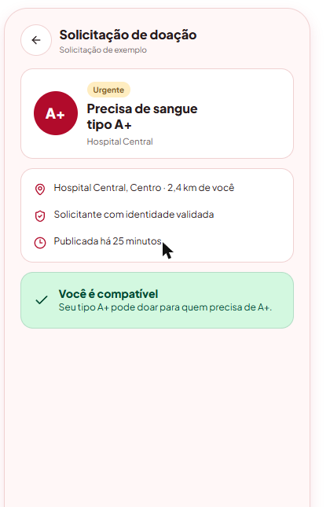
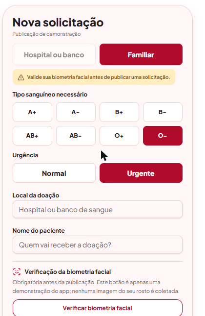
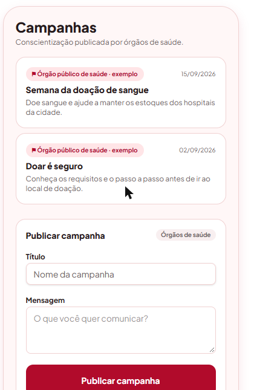
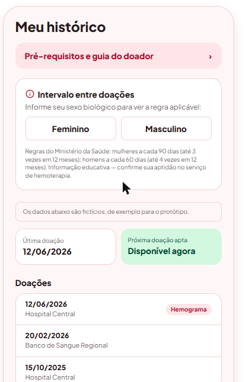
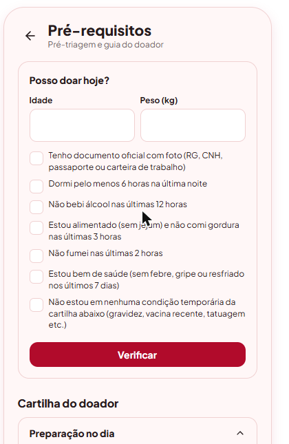

# Protótipo — ConectaSangue

**Link público:** https://conecta-sangue.lovable.app

O protótipo é a própria aplicação publicada pelo Lovable, aberta em qualquer navegador, sem login e sem permissão privada. Não há arquivo de Figma. As imagens desta pasta são as exportações das telas, feitas do protótipo em execução.

## Como navegar sem conta

1. Abra o link e toque em "Ver início de exemplo".
2. Toque na solicitação do Hospital Central.
3. Use a barra inferior para ir a Campanhas, Pedir sangue e Histórico.

Passo a passo completo: [`../docs/fluxos-de-tela.md`](../docs/fluxos-de-tela.md). Guia de uso: [`../manuais/manual-do-usuario.md`](../manuais/manual-do-usuario.md).

## Telas

| # | Tela | Rota | Exportação |
|---|---|---|---|
| 1 | Cadastro do doador | `/` |  |
| 2 | Início | `/inicio` |  |
| 3 | Solicitação | `/solicitacao?id=hospital-central` |  |
| 4 | Nova solicitação | `/nova-solicitacao` |  |
| 5 | Campanhas | `/campanhas` |  |
| 6 | Histórico | `/historico` |  |
| 7 | Pré-requisitos | `/pre-requisitos` |  |

As imagens mostram a parte superior de cada tela, com o aplicativo sem conta (dados de exemplo), e foram capturadas em 04/11/2026.

## Fluxos

```
Fluxo principal:    Cadastro (1) → Início (2) → Solicitação (3)
Pedir sangue:       Início (2) → Nova solicitação (4) → Início (2)
Aptidão:            Início (2) → Pré-requisitos (7)
Intervalo de doação: Histórico (6) → Pré-requisitos (7)
Campanhas:          Início (2) → Campanhas (5)
```

Mapa Model, View e Controller de cada fluxo: [`../docs/arquitetura-mvc-camadas.md`](../docs/arquitetura-mvc-camadas.md).

## Limites do protótipo

Solicitações, campanhas, doações, hemograma e distâncias de exemplo são fictícios. Notificação, biometria e "Confirmar interesse" são demonstrações. Escopo completo: [`../docs/escopo.md`](../docs/escopo.md).
